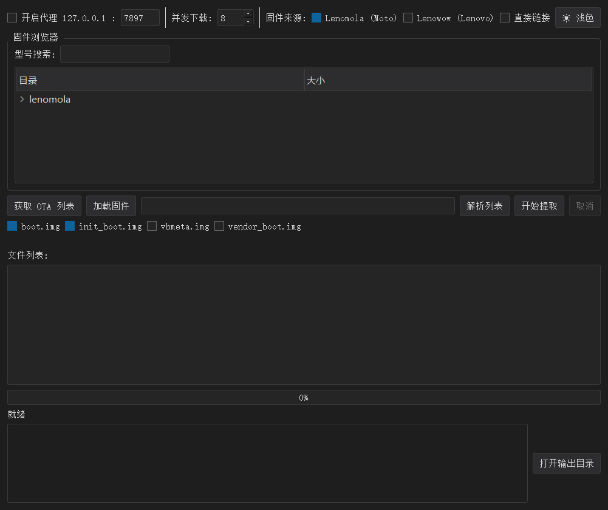
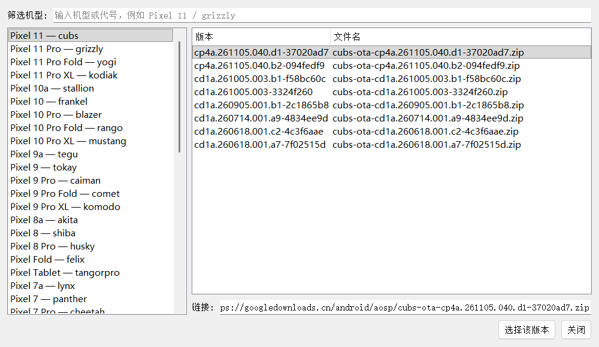

# 固件远程提取工具 (img-extractor)

从 Android Full OTA 固件包（`.zip`）里**按需**提取 `boot.img` / `init_boot.img` / `vbmeta.img` / `vendor_boot.img` 等分区镜像。
全程走 HTTP `Range` 请求，**不下载整个固件包**（动辄 2–4 GB），只取目标分区真正用到的字节段。




## 功能

- **远端 ZIP 探测**：只读 ZIP 尾部 EOCD + 中央目录，即可列出包内文件/分区，无需下载整包
- **AOSP payload 解析**：支持 `payload.bin` 的 `CrAU` 头 + `DeltaArchiveManifest`（protobuf），按分区提取
- **多线程并行下载**：默认 8 并发（1–16 可调），按 8 MB 分块并发抓取 + 失败退避重试（5/10/20/40/60 s）
- **实时网速显示**：`↓ 23.4 MB/s · 已下载 1.2 GB / 3.4 GB · 剩余 01:23`
- **目录名智能推导**：修掉直链提取时目录名乱码 / 变成 `download` / 变成空目录的问题
  - 百分号编码（UTF-8 / GBK）自动解码
  - `cp1252`/`latin-1` 误解码的中文自动还原（`系统` → `系统`）
  - 预签名直链优先读 URL 里的 `response-content-disposition`，路径是 UUID 也能拿到真名
  - URL 里没有文件名时读响应头 `Content-Disposition`，再不行回退 `主机名_哈希`
- **来源发现**：h5ai 镜像目录树懒加载（Lenomola / Lenowow）、**谷歌 OTA** 机型-版本列表、
  **小米 / HyperOS OTA 机型库**
  - **小米 OTA**：点「小米 OTA」按钮，从融合数据源（[HyperData](https://github.com/HegeKen/HyperData)
    + [xiaomirom.com](https://xiaomirom.com/)）选机型/版本，自动拼出小米官方直链；
    机型按品牌分组（小米 / REDMI / POCO），组内新机型在前
    - **机型互补**：HyperData 有 180 个机型（更新快），xiaomirom.com 补漏 157 个 MIUI 老机型（标记 `[W]`），合计 337 个
    - **下载节点优先第 4 个**：每个版本的 5 个下载直链里优先用阿里云 OSS（最稳），不足时回退
    - **机型按发布时间排列**：小米 18/17 在小米 13/10 上，品牌分组保留
    - **版本按大版本+发布时间排列**：澎湃 OS4 在 OS3 上、MIUI V14 在 V13 上
    - **四个下载源可选**：下拉框选 1 bigota / 2 bn / 3 cdnorg / 4 阿里云 OSS，**默认第 4 个**（最稳），切换即时生效
  - OTA 列表重排版：左侧机型列表（`Pixel 11 Pro XL — kodiak`，可筛选），右侧
    `版本` / `文件名` 两列，底部实时显示链接；页面上的冗长标题会被压成干净机型名
    （`Pixel 11 的代号为“cubs”` → `Pixel 11`）
  - **机型从新到旧**：按发布年份倒序（`Pixel 11` → `Pixel 10` → `10a` → `9a` → … → `Nexus 7`），
    版本按构建号里的 `YYMMDD` 倒序，新包在前

    

  - 镜像站已按年份分流：`mirrors.lolinet.com`（主站）、`mirrors-obs-1.lolinet.com`（2020–2021）、
    `mirrors-obs-2.lolinet.com`（2015–2019）。程序在某站目录为空时**自动切换其它镜像主机**，
    无需手动改地址
- **可取消**：提取中途随时停止，不残留半成品写入线程
- **深色模式**：右上角 `🌙 深色 / ☀️ 浅色` 按钮一键切换，偏好自动记住（写入 exe 同级的 `theme.txt`）；
  也可用 `--theme=dark` 命令行参数强制以深色启动
- **镜像稀疏写入**：`seek + write` 天然稀疏，ZERO 分区几秒落盘、实际占用极小

> 当前版本 **v2.4.2** · 变更记录见 [CHANGELOG.md](CHANGELOG.md)

## 临时文件在哪

| 场景 | 位置 | 是否自动删除 |
|---|---|---|
| 提取数据 ≤ 256 MB | 内存 | — |
| 提取数据 > 256 MB | `%TEMP%\fw_buf_<随机>.bin`（日志会打印完整路径） | 提取结束/取消即删；进程被强杀则下次启动清理 2 小时前的残留 |
| 单文件 exe 自身解包 | `%TEMP%\_MEIxxxxx\` | 退出时删 |
| 最终产物 | exe 同级 `extracted_images\<固件名>\` | 不删 |

## 支持的 OTA 类型

| op 类型 | 说明 |
|---|---|
| `0` REPLACE | 原始数据 |
| `1` REPLACE_BZ | bzip2 |
| `6` ZERO | 写零 |
| `7` DISCARD | 跳过 |
| `8` REPLACE_XZ | xz / lzma |
| `14` ZSTD | zstd |
| 其它（BSDIFF / PUFFDIFF / ZUCCHINI …） | 增量包，不支持，会明确报错 |

## 小米 OTA 使用方法

1. 点主界面「**小米 OTA**」按钮 → 打开机型浏览器
2. 左侧筛选或单击/双击机型（如输入 `K70`），右侧会**异步加载**该机型的所有版本
   （首次需联网几秒，status 会显示"正在加载…"，加载完显示"✓ 共 N 个版本"）
3. 右侧按发布日期从新到旧列出版本，**双击任意版本**（或选中后点"选择该版本"），
   链接自动填入主界面的链接框
4. 回主界面点「**解析列表**」→ 勾选 `boot.img` 等分区 → 点「**开始提取**」

> 新发布的机型（带 `[新 MM-DD]` 标记）排在机型分组最顶端，最新 OTA 包排在版本列表最顶端。
> 机型来源：`[W]` 表示来自 xiaomirom.com 补漏的 MIUI 老机型，其余来自 HyperData。
> 下载优先用页面第 4 个节点（阿里云 OSS，最稳）。
> 小米 CDN 带宽较低，提取分区时会显示实时网速，属正常现象。

## 直接使用

下载 Release 里的 `FirmwareExtractor.exe`，双击运行，**单文件、免安装**。

1. 选固件来源（Moto / Lenovo），浏览器里展开目录；单击 zip 节点即填入链接
   （展开任意目录会一次预加载三层，往下翻不用再等）
2. 点「解析列表」→ 勾选要提取的分区（或直接勾 `boot.img` 等快捷项）
3. 点「开始提取」，完成后自动打开输出目录

输出目录：exe 同级的 `extracted_images/<固件名>/`。

## 从源码运行

```powershell
python -m pip install -r requirements.txt
python qt_extractor.py
```

若依赖装在工程的 `libs/` 目录（推荐，绿色隔离）：

```powershell
python -m pip install --target libs -r requirements.txt
$env:PYTHONPATH = "$PWD\libs"
python qt_extractor.py
```

## 测试

三套测试都可以直接跑，返回码 `0` 表示全部通过。

### 1. 离线自检（23 项，不需要联网）

```powershell
python qt_extractor.py --selftest
# 或对打好的 exe：
.\dist\FirmwareExtractor.exe --selftest
```

覆盖：目录名推导（UTF-8/GBK 百分号编码、cp1252 乱码、保留名、超长名共 7 例）、
预签名 `response-content-disposition` 取名、HEAD 403 时用 1 字节 GET 取名、
镜像候选改写、测速、已回收线程过滤、端到端合成 Full OTA（`raw/zstd/bz2/xz/zero` 五种 op）、
1 线程 vs 8 线程输出一致性、取消、普通 zip 并行提取、GUI 窗口冒烟。
结果写入 `selftest.log`。

### 2. 端到端点测（15 项，联网 + 真实固件）

```powershell
python qt_extractor.py --e2e=e2e.log
.\dist\FirmwareExtractor.exe --e2e=e2e.log
```

驱动真实窗口、点真实按钮，逐项验证：GUI 启动、目录树根节点、展开年份（镜像兜底）、
展开机型目录、单击 zip 填链接、型号搜索、来源切换、获取 Google OTA 列表、
解析真实 Full OTA、真实提取 `boot.img`（校验 `ANDROID!` 魔数 + 实时网速 + 进度 100）、
提取中取消、代理可用、代理端口不可用不崩、打开输出目录、关闭窗口。

### 3. 目录树回归

```powershell
python qt_extractor.py --expand-demo
```

自动展开「根 → 第一个年份」，把过程写进 `expand-demo.log`。
专治「点年份闪退」这类只在交互路径上出现的问题。

## 打包单文件 exe

一条命令（推荐）：

```powershell
powershell -NoProfile -ExecutionPolicy Bypass -File .\build.ps1
```

`build.ps1` 会把依赖和打包工作区放到 **ASCII 临时目录**再构建，最后只把 exe 拷回
`dist\FirmwareExtractor.exe`——因为 PyInstaller 的 Qt 钩子与 onefile 引导器都不认
中文路径，直接在中文目录构建会报 `Qt plugin directory ... does not exist!`。
打包完成后还会自动拷一份到 **`E:\tools\A-IMG提取\FirmwareExtractor.exe`**（日常使用版）。
若该程序正在运行导致无法覆盖，脚本会提示先关闭程序，dist 里的产物仍可用。

手动等价命令（项目路径必须是纯 ASCII）：

```powershell
python -m PyInstaller --noconfirm --clean --onefile --windowed `
  --name FirmwareExtractor --icon app.ico --add-data "app.ico;." `
  --paths libs qt_extractor.py
```

产物：`dist/FirmwareExtractor.exe` 和 `E:\tools\A-IMG提取\FirmwareExtractor.exe`（各约 57 MB）。
PyInstaller 的产物**不是逐字节可复现**的（内嵌时间戳），请用 `--selftest` 而不是哈希来验收。

## 文件说明

| 文件 | 说明 |
|---|---|
| `qt_extractor.py` | 主程序（PyQt5 GUI + 并行下载 + 提取核心 + 自检） |
| `payload_extractor.py` | OTA payload 解析：`CrAU` 头、manifest、extent 落盘 |
| `update_metadata_pb2.py` | `update_metadata.proto` 生成代码（protobuf） |
| `build.ps1` | 一键装依赖 + 打包单文件 exe |
| `requirements.txt` | 运行依赖 |
| `docs/screenshot.png` | 界面截图 |

> v1 的 tkinter 版本（`extractor.py`）与打包残留脚本已退役，需要考古请查 `git log`。

## 注意

- 工具只做**完整包（Full OTA）**；增量包（`payload` 里带 bsdiff 系列 op）不受支持。
- 部分镜像站不支持 `Range`，此时会明确提示而不是产出坏镜像。
- 校验：下载的每个 op 数据都会比对 manifest 里的 `data_sha256_hash`；不一致立即中止。
- onefile 程序启动时需要往 `%TEMP%` 解包：请把 exe 放在常规目录
  （`D:\tools\`、桌面等）。**受组策略/沙箱限制为低完整性（Low Integrity）的目录**
  （部分 OneDrive 同步目录、安全软件隔离区、某些工作区）会导致
  `Could not create temporary directory!`，换个目录即可。
- 镜像站按年份分流：`mirrors.lolinet.com`（主站）、`mirrors-obs-1`（2020–2021）、
  `mirrors-obs-2`（2015–2019），程序目录为空时自动换主机。

## 致谢

- payload 格式参考 AOSP `update_engine` 与 [Payload-Dumper-Android](https://github.com/rajmani7584/Payload-Dumper-Android)


