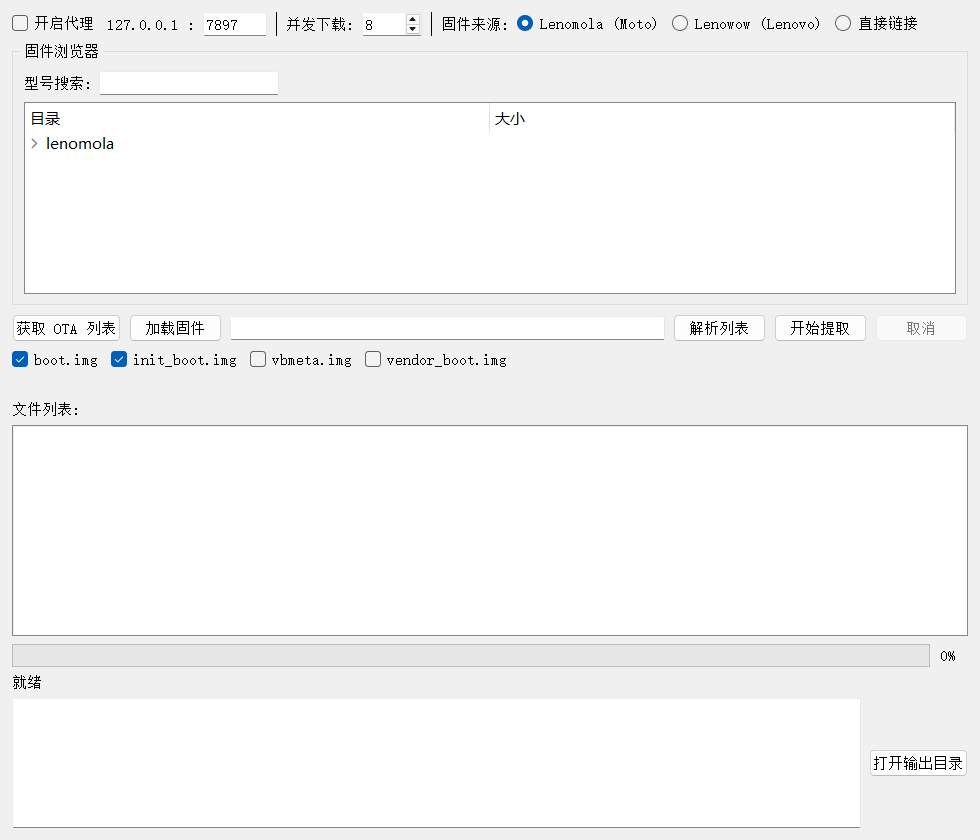

# 固件远程提取工具 (img-extractor)

从 Android Full OTA 固件包（`.zip`）里**按需**提取 `boot.img` / `init_boot.img` / `vbmeta.img` / `vendor_boot.img` 等分区镜像。
全程走 HTTP `Range` 请求，**不下载整个固件包**（动辄 2–4 GB），只取目标分区真正用到的字节段。



## 功能

- **远端 ZIP 探测**：只读 ZIP 尾部 EOCD + 中央目录，即可列出包内文件/分区，无需下载整包
- **AOSP payload 解析**：支持 `payload.bin` 的 `CrAU` 头 + `DeltaArchiveManifest`（protobuf），按分区提取
- **多线程并行下载**：默认 8 并发（1–16 可调），按 8 MB 分块并发抓取 + 失败退避重试（5/10/20/40/60 s）
- **实时网速显示**：`↓ 23.4 MB/s · 已下载 1.2 GB / 3.4 GB · 剩余 01:23`
- **目录名智能推导**：修掉直链提取时目录名乱码 / 变成 `download` / 变成空目录的问题
  - 百分号编码（UTF-8 / GBK）自动解码
  - `cp1252`/`latin-1` 误解码的中文自动还原（`系统` → `系统`）
  - URL 里没有文件名时读 `Content-Disposition`，再不行回退 `主机名_哈希`
- **来源发现**：h5ai 镜像目录树懒加载（Lenomola / Lenowow）、Google OTA 机型-版本列表
- **可取消**：提取中途随时停止，不残留半成品写入线程
- **镜像稀疏写入**：`seek + write` 天然稀疏，ZERO 分区几秒落盘、实际占用极小

## 支持的 OTA 类型

| op 类型 | 说明 |
|---|---|
| `0` REPLACE | 原始数据 |
| `1` REPLACE_BZ | bzip2 |
| `6` ZERO | 写零 |
| `7` DISCARD | 跳过 |
| `8` REPLACE_XZ | xz / lzma |
| `14` ZSTD | zstd |
| 其它（BSDIFF / PUFFDIFF / ZUCCHINI …） | 增量包，不支持，会明确报错 |

## 直接使用

下载 Release 里的 `FirmwareExtractor.exe`，双击运行，**单文件、免安装**。

1. 选固件来源（或用「直接链接」粘贴 OTA 直链）
2. 点「解析列表」→ 勾选要提取的分区（或直接勾 `boot.img` 等快捷项）
3. 点「开始提取」，完成后自动打开输出目录

输出目录：exe 同级的 `extracted_images/<固件名>/`。

## 从源码运行

```powershell
python -m pip install -r requirements.txt
python qt_extractor.py
```

若依赖装在工程的 `libs/` 目录（推荐，绿色隔离）：

```powershell
python -m pip install --target libs -r requirements.txt
$env:PYTHONPATH = "$PWD\libs"
python qt_extractor.py
```

## 自检

```powershell
python qt_extractor.py --selftest
# 或对打好的 exe：
.\dist\FirmwareExtractor.exe --selftest
```

自检覆盖：目录名推导（7 种乱码/伪文件名场景）、测速、端到端全流程（本地 Range 服务器 + 合成 Full OTA，
raw/zstd/bz2/xz/zero 五种 op）、1 线程与 8 线程输出一致性、取消机制、普通 zip 并行提取、
`Content-Disposition` 兜底。结果写入 `selftest.log`，返回码 `0` 表示全部通过。

## 打包单文件 exe

```powershell
python -m PyInstaller --noconfirm --clean --onefile --windowed `
  --name FirmwareExtractor --icon app.ico --add-data "app.ico;." `
  --paths libs qt_extractor.py
```

产物：`dist/FirmwareExtractor.exe`。

## 文件说明

| 文件 | 说明 |
|---|---|
| `qt_extractor.py` | PyQt5 主程序（GUI + 并行下载 + 提取核心 + 自检） |
| `payload_extractor.py` | OTA payload 解析：`CrAU` 头、manifest、extent 落盘 |
| `update_metadata_pb2.py` | `update_metadata.proto` 生成代码（protobuf） |
| `extractor.py` | 早期 tkinter 版本（保留参考） |

## 注意

- 工具只做**完整包（Full OTA）**；增量包（`payload` 里带 bsdiff 系列 op）不受支持。
- 部分镜像站不支持 `Range`，此时会明确提示而不是产出坏镜像。
- 校验：下载的每个 op 数据都会比对 manifest 里的 `data_sha256_hash`；不一致立即中止。
